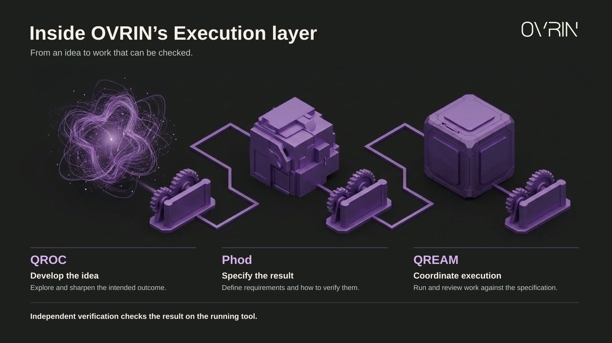

# QROC

A rough idea rarely arrives as a specification. QROC gives it a project record and a review process so that someone can decide when it is ready to advance. Its Rust library powers a line-oriented JSON bridge and a QML interface.



QROC occupies the first position in this flow. You can try its intake bridge independently, with a one-sentence brief and an empty project directory.

## Create your first project

Use Rust 1.94.0 and a C compiler. Cargo fetches the locked crates on the first build. The first-party stratum-api dependency is included.

```sh
cargo build --locked --bin qroc-bridge
target/debug/qroc-bridge --root "$(mktemp -d)" <<'REQUESTS'
{"version":1,"id":"new","command":"qroc-project-create","args":{"title":"Orchard","brain_dump":"Irrigation controls"}}
{"version":1,"id":"list","command":"qroc-project-list","args":{}}
{"version":1,"id":"bad","command":"qroc-not-real","args":{}}
REQUESTS
```

Read the replies in order. The bridge accepts **Orchard**, lists the new project, then returns a structured rejection for the unknown command. Each input line is one complete request.

## See what stops work

Install FFmpeg for the creative conversion tests, then run the library and bridge suites.

```sh
QROC_TEST_ROOT="$(mktemp -d)" cargo test --locked --lib
cargo test --locked --test t01-bridge
```

The library case `failed_gate_blocks_ready_batch_without_a_provider_request` checks an important boundary: when a gate fails, the ready batch stops before a provider receives a request.

The verified path covers the library and bridge. The graphical interface needs Quickshell. A live passing gate requires a configured key service and an authorized provider. The packaged Phod semantic and derive sources built locally. GUI installation and a live provider-backed passing gate remain open. The candidate follows release `qroc-20261031-keysvc-d02`. See [dependency notices](THIRD_PARTY_NOTICES.md).

---

**[Explore OVRIN Labs](https://ovrinlabs.ca/)** · [Citium research](https://citium.ovrinlabs.ca/) · [Zavent data tools](https://zaventdata.com/)

[Apache-2.0 license](LICENSE) · [Contributing](CONTRIBUTING.md) · [Report a vulnerability privately](SECURITY.md)

Historical workstation-specific acceptance harnesses are held outside this public source copy. The documented source-built tests remain the supported receiving checks.
